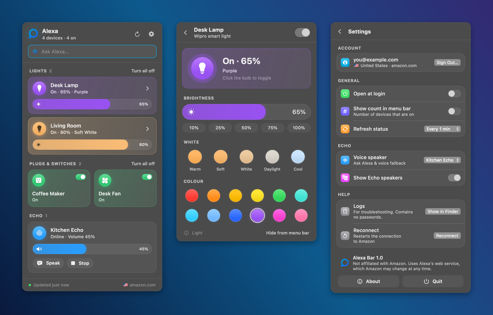
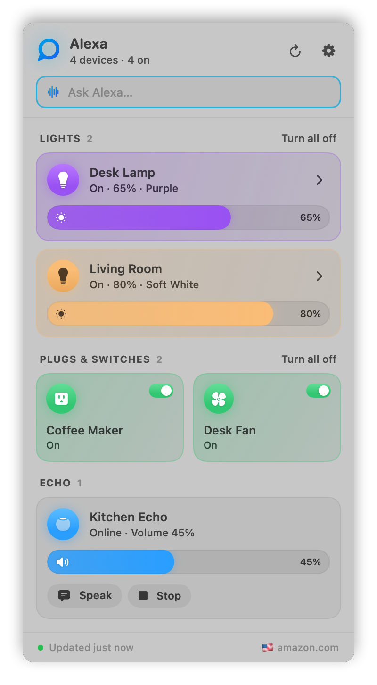
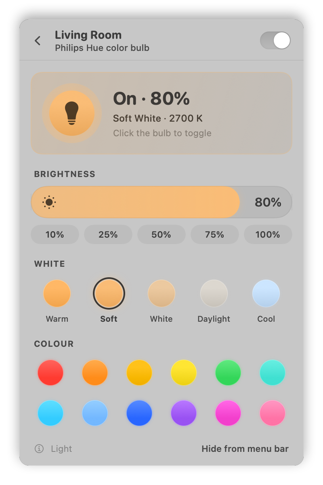
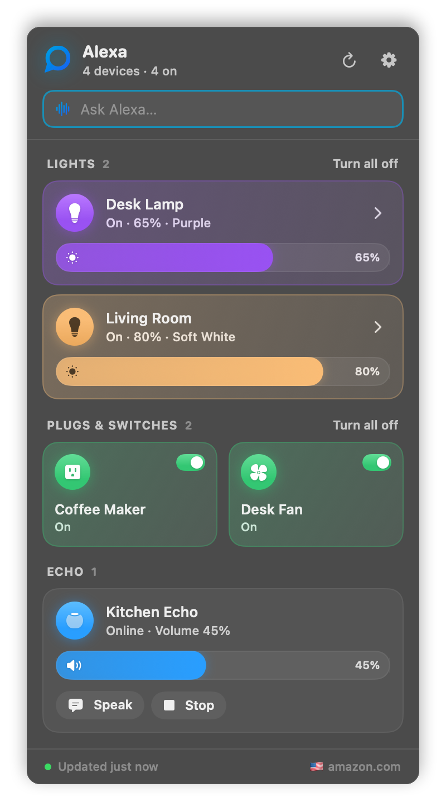
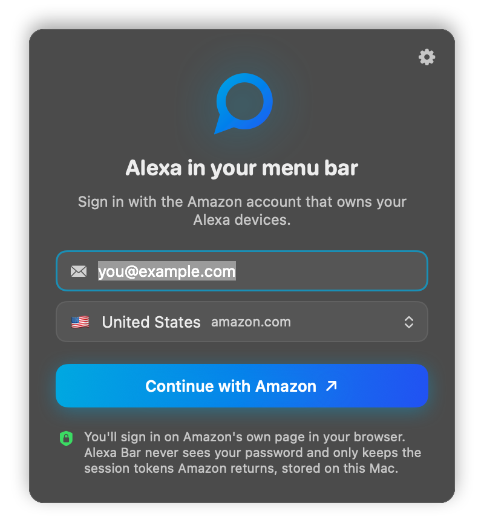

<p align="center">
  
</p>

<h1 align="center">Alexa Bar</h1>

<p align="center">
  <strong>Your Alexa smart home, one click away in the macOS menu bar.</strong><br>
  Lights, plugs, switches and Echo speakers in a fast, native panel.
</p>

<p align="center">
  <a href="https://github.com/flerk3n/Alexa-Bar/releases/latest"></a>
  
  
  
  <a href="LICENSE"></a>
</p>

<p align="center">
  <a href="https://github.com/flerk3n/Alexa-Bar/releases/latest"><strong>Download for Mac</strong></a>
  ·
  <a href="#install">Install</a>
  ·
  <a href="#features">Features</a>
  ·
  <a href="#troubleshooting">Troubleshooting</a>
  ·
  <a href="#build-from-source">Build from source</a>
</p>

<p align="center">
  
</p>

---

## Why

Turning off a lamp shouldn't mean finding your phone, unlocking it and
opening the Alexa app. Alexa Bar puts your devices where you already are:
the menu bar. Click the ring, tap a light, done.

## Features

**Lights**
- On/off with one click, brightness by dragging the card's slider.
- Detail page with brightness presets, 5 white temperatures (warm to cool)
  and 12 colours.
- Each card glows in the colour the bulb is actually showing.

**Plugs and switches**
- Compact tiles you click to toggle, and **Turn all off** per section.

**Echo speakers**
- Volume slider, **Speak** (make it say any text) and **Stop**.
- **Ask Alexa**: type anything you would say out loud, such as
  "turn off the lights in 10 minutes" or "what's the weather", and your Echo
  does it.

**Built like a Mac app**
- Native SwiftUI, light and dark mode, no Dock icon.
- **Open at Login**, offered once after you sign in.
- Changes show instantly and roll back if Amazon rejects them.
- Status refreshes on a timer, when you open the panel, after sleep and when
  the network comes back. An offline banner tells you when you're
  disconnected.
- Keyboard shortcuts, VoiceOver labels, optional count of devices that are on
  next to the menu bar icon.
- Self-contained: nothing else to install.

**Reliable with Amazon**
- If Amazon refuses direct control of a device, the command is sent through
  your Echo instead.
- Sliders are debounced and repeated commands coalesced, so dragging doesn't
  trip Amazon's rate limit (HTTP 429). If it happens anyway, the app backs off
  and retries.

<table>
  <tr>
    <td align="center"><br><sub>Light mode</sub></td>
    <td align="center"><br><sub>Light controls</sub></td>
  </tr>
  <tr>
    <td align="center"><br><sub>Dark mode</sub></td>
    <td align="center"><br><sub>Sign in with your Amazon account</sub></td>
  </tr>
</table>

## Requirements

- macOS 14 Sonoma or later
- A Mac with Apple silicon (M1 or later)
- An Amazon account with Alexa devices, in one of the
  [supported regions](#supported-regions)

## Install

1. Download **Alexa-Bar-x.y.z.dmg** from the
   [latest release](https://github.com/flerk3n/Alexa-Bar/releases/latest).
2. Open the disk image and drag **Alexa Bar** to **Applications**.
3. Open **Alexa Bar** from Applications.

### First launch

Release builds aren't notarized by Apple yet, so macOS asks you to confirm
the first time:

1. Open the app once. macOS says it can't verify it. Click **Done**.
2. Open **System Settings › Privacy & Security**, scroll down and click
   **Open Anyway** next to "Alexa Bar", then confirm.

Or, in Terminal:

```sh
xattr -dr com.apple.quarantine "/Applications/Alexa Bar.app"
```

### Sign in

1. Click the ring icon in the menu bar.
2. Enter your Amazon email, check the region and click
   **Continue with Amazon**.
3. Amazon's own sign-in page opens in your browser. Sign in there, including
   any verification code. The panel fills with your devices when you're done.

You stay signed in across restarts. **Settings › Sign Out** removes the
saved session.

## Usage

| Action | How |
| --- | --- |
| Toggle a device | Click its card or tile |
| Set brightness or volume | Drag the slider on the card |
| Colours and white temperatures | Click **›** on a light card |
| More options for a device | Right-click it (turn on, turn off, hide) |
| Send any command | Type in **Ask Alexa…** and press Return |
| Choose which Echo runs commands | Settings › Echo › Voice speaker |
| Hide a device | Right-click › Hide from Menu Bar (restore in Settings) |

| Shortcut | Action |
| --- | --- |
| <kbd>⌘</kbd> <kbd>R</kbd> | Refresh devices |
| <kbd>⌘</kbd> <kbd>,</kbd> | Settings |
| <kbd>Esc</kbd> | Back |
| <kbd>⌘</kbd> <kbd>Q</kbd> | Quit (from Settings) |

## Supported devices

Anything Alexa can control appears, with controls matching what the device
supports:

| Device | Controls |
| --- | --- |
| Lights and bulbs | Power, brightness, colour, white temperature |
| Smart plugs and switches | Power |
| Fans, TVs, computers and other appliances behind a plug | Power |
| Echo, Echo Dot, Echo Show | Volume, speak, stop, typed commands |

Other device types (thermostats, locks, sensors) appear when Alexa reports
controls for them, with a power toggle where they support one. Dedicated
controls for those types aren't built yet.

### Supported regions

🇺🇸 amazon.com · 🇮🇳 amazon.in · 🇬🇧 amazon.co.uk · 🇨🇦 amazon.ca ·
🇦🇺 amazon.com.au · 🇩🇪 amazon.de · 🇫🇷 amazon.fr · 🇮🇹 amazon.it ·
🇪🇸 amazon.es · 🇯🇵 amazon.co.jp · 🇧🇷 amazon.com.br · 🇲🇽 amazon.com.mx

## Privacy and security

- **Your password never reaches Alexa Bar.** You type it into Amazon's own
  page. A temporary proxy on `127.0.0.1` relays that page so Amazon can hand
  back session tokens, and it stops as soon as sign-in finishes.
- **Tokens stay on your Mac** in
  `~/Library/Application Support/Alexa Bar/`, readable only by your user.
  Sign Out deletes them.
- **No servers, analytics or tracking.** The app talks only to Amazon's
  Alexa servers for your region.
- **Logs** in `~/Library/Logs/Alexa Bar/` contain no passwords or tokens.

## Troubleshooting

<details>
<summary><strong>"Amazon is limiting requests right now"</strong></summary>

Amazon answers HTTP 429 (Too Many Requests) when an account sends many
commands in a short time, Echo commands especially. Alexa Bar already
debounces sliders and retries with back-off. Wait a few seconds and try
again.
</details>

<details>
<summary><strong>Sign-in page doesn't open, or sign-in times out</strong></summary>

Click **Open Sign-in Page** on the waiting screen, or **Copy link** and paste
it into another browser. Sign-in waits up to 10 minutes. Make sure the region
matches the Amazon site you use for Alexa.
</details>

<details>
<summary><strong>A device is missing</strong></summary>

Check that it appears in the Alexa app and that you didn't hide it
(Settings › Hidden devices). Then click refresh (<kbd>⌘</kbd> <kbd>R</kbd>).
</details>

<details>
<summary><strong>"Sent through your Echo"</strong></summary>

Amazon sometimes refuses direct control for a device or region. Alexa Bar
then sends the command as if you had spoken it to your Echo, which may answer
out loud. Pick the Echo to use in Settings › Echo.
</details>

<details>
<summary><strong>"Your Amazon session expired"</strong></summary>

Amazon occasionally ends sessions, for example after a password change. Sign
in again from the panel.
</details>

<details>
<summary><strong>Something else</strong></summary>

Settings › Help › **Reconnect** restarts the connection. For a bug report,
attach `~/Library/Logs/Alexa Bar/helper.log` (Settings › Help › Logs ›
Show in Finder) to a [new issue](https://github.com/flerk3n/Alexa-Bar/issues).
</details>

### Uninstall

Quit Alexa Bar (Settings › Quit), delete it from Applications, then remove
its data:

```sh
rm -rf ~/Library/"Application Support/Alexa Bar" ~/Library/Logs/"Alexa Bar"
defaults delete com.alexabar.AlexaBar
```

## How it works

```
Alexa Bar.app
├── Contents/MacOS/AlexaBar          SwiftUI menu bar app: all UI and state
└── Contents/Resources/helper/
    ├── python/                      standalone CPython 3.12
    ├── site-packages/               AlexaPy and dependencies
    ├── alexabar_helper/             Amazon session and API layer
    └── run_helper.py
```

The Swift app starts a small Python helper as a child process and exchanges
one JSON object per line over stdin/stdout
([`protocol.py`](backend/alexabar_helper/protocol.py)). The helper wraps
[AlexaPy](https://gitlab.com/keatontaylor/alexapy) for Amazon's sign-in, then
uses the same web endpoints as the Alexa website:

| Purpose | Endpoint |
| --- | --- |
| Smart home device list | `GET /api/behaviors/entities` |
| Device status | `POST /api/phoenix/state` |
| Device control | `PUT /api/phoenix/state` |
| Echo speak, volume, stop, typed commands | `POST /api/behaviors/preview` |
| Echo list and volume | `/api/devices-v2/device`, `/api/devices/…/allDeviceVolumes` |

These are private Amazon APIs. They work today but can change without notice.

## Build from source

Requirements: macOS 14+, the Xcode Command Line Tools
(`xcode-select --install`) and internet access on the first build, which
downloads a pinned, SHA-256 verified Python runtime.

```sh
git clone https://github.com/flerk3n/Alexa-Bar.git
cd Alexa-Bar
make install   # builds build/Alexa Bar.app, copies it to /Applications and opens it
```

| Command | Result |
| --- | --- |
| `make app` | `build/Alexa Bar.app` |
| `make dmg` | `build/Alexa-Bar-<version>.dmg` |
| `make install` | Build, install to `/Applications`, open |
| `make clean` | Remove build output |

Signed and notarized release:

```sh
VERSION=1.1.0 SIGN_IDENTITY="Developer ID Application: Your Name (TEAMID)" make app
NOTARY_PROFILE=<notarytool keychain profile> scripts/make_dmg.sh
```

### Project structure

| Path | Contents |
| --- | --- |
| [`Sources/AlexaBar/App`](Sources/AlexaBar/App) | App entry, `AppModel` and its actions |
| [`Sources/AlexaBar/Backend`](Sources/AlexaBar/Backend) | Helper process client |
| [`Sources/AlexaBar/Models`](Sources/AlexaBar/Models) | Devices, states, presets, regions |
| [`Sources/AlexaBar/Support`](Sources/AlexaBar/Support) | Preferences, login item, logging, network |
| [`Sources/AlexaBar/Views`](Sources/AlexaBar/Views) | SwiftUI views and components |
| [`backend/alexabar_helper`](backend/alexabar_helper) | Python helper package |
| [`Packaging`](Packaging) | Info.plist template, entitlements |
| [`scripts`](scripts) | Build, DMG, install, Python fetcher, icon renderer |

> On recent SDKs SwiftUI's `@State` is a macro whose compiler plugin ships
> only with Xcode. The views use `@ViewState`, an alias for SwiftUI's `State`
> property wrapper, so the project also builds with just the Command Line
> Tools.

## Contributing

Bug reports and pull requests are welcome. For larger changes, please open an
issue first to discuss the idea. When reporting a bug, include your macOS
version, Amazon region, the device type, and the relevant lines from
`~/Library/Logs/Alexa Bar/helper.log`.

## Acknowledgements

- [AlexaPy](https://gitlab.com/keatontaylor/alexapy) by Keaton Taylor and
  Alan Tse, which handles Amazon's sign-in.
- [alexa-remote2](https://github.com/Apollon77/alexa-remote), whose work
  documented many of the Alexa endpoints.
- [python-build-standalone](https://github.com/astral-sh/python-build-standalone)
  for the relocatable Python runtime.

Full list of bundled software and licenses:
[THIRD_PARTY_NOTICES.md](THIRD_PARTY_NOTICES.md).

## Disclaimer

Alexa Bar is an independent project. It is not affiliated with, endorsed by
or sponsored by Amazon. Alexa, Echo and related marks are trademarks of
Amazon.com, Inc. or its affiliates. Use it at your own risk; Amazon may
change or restrict the services it relies on at any time.

## License

[MIT](LICENSE) © 2026 flerk3n
